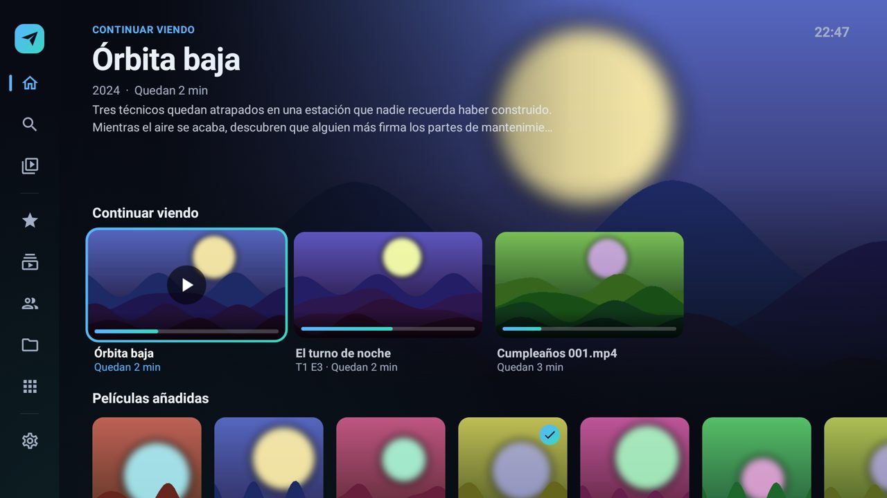
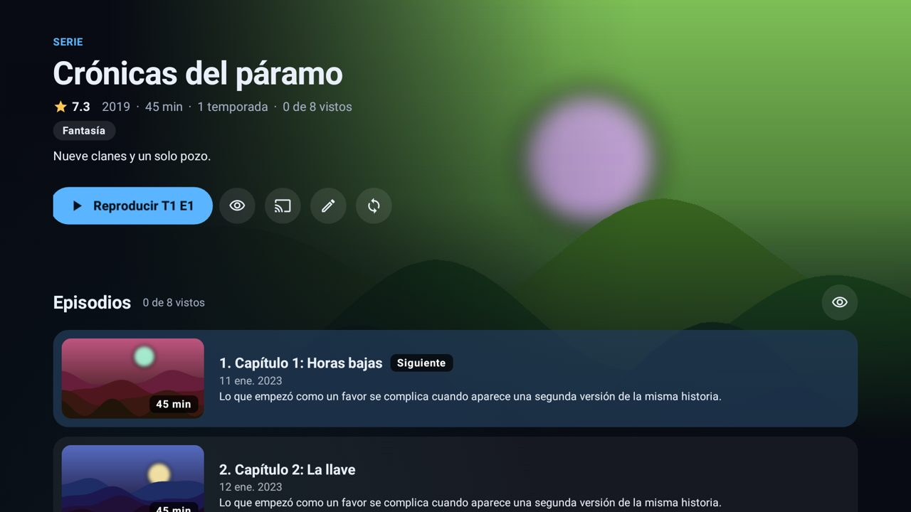
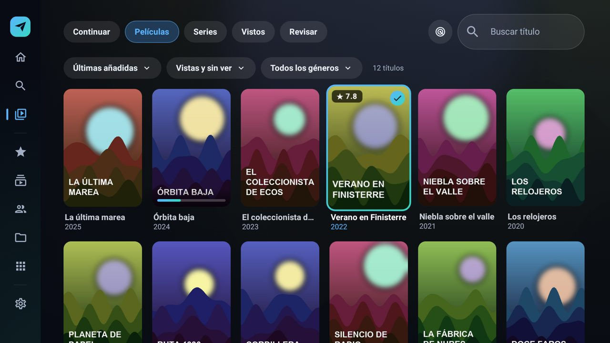
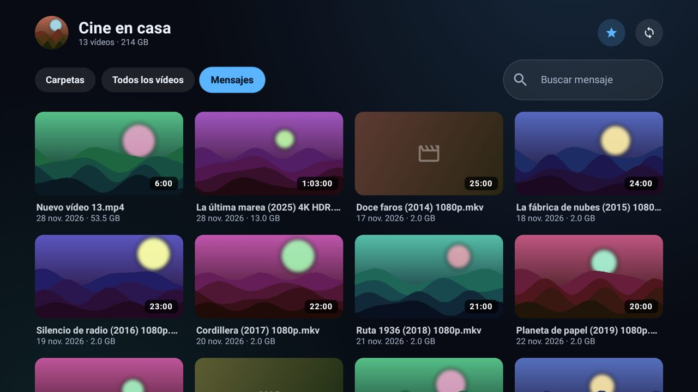
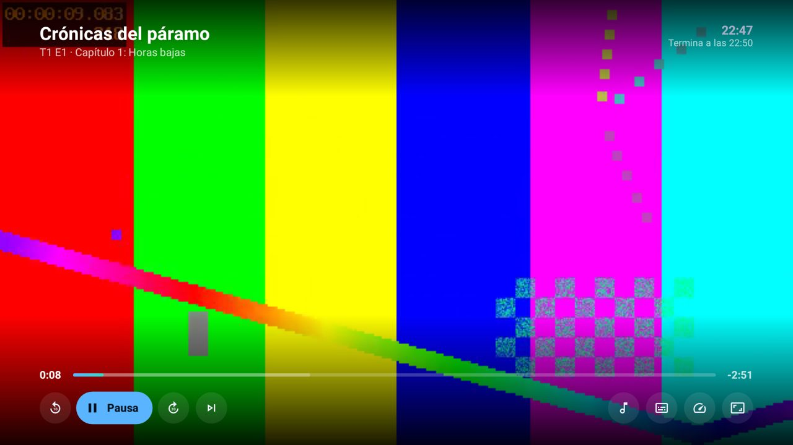
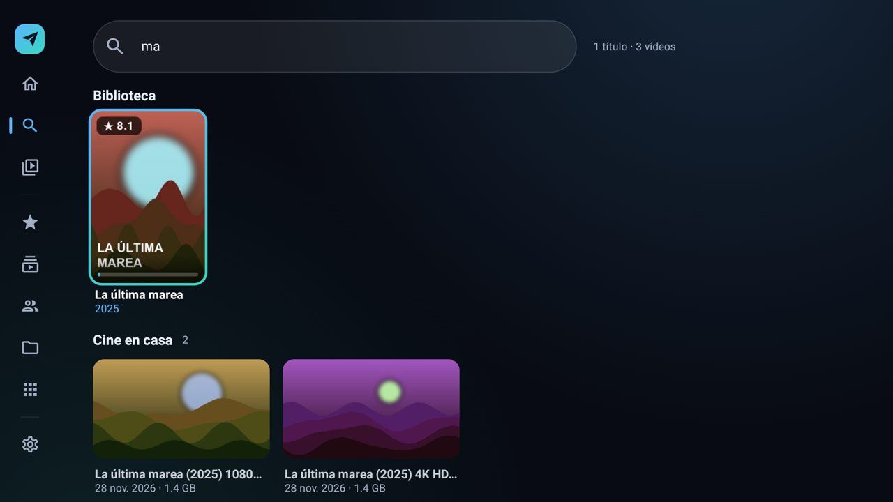

# TFM TV

<p align="center">
  <a href="https://github.com/mateof/tfm-android-tv-app/actions/workflows/release.yml"></a>
  <a href="https://github.com/mateof/tfm-android-tv-app/releases/latest"></a>
  <a href="https://github.com/mateof/tfm-android-tv-app/releases"></a>
  <a href="https://developer.android.com/tv"></a>
  <a href="https://kotlinlang.org/"></a>
  <a href="LICENSE"></a>
  <a href="https://github.com/mateof/tfm-android-tv-app/commits/main"></a>
</p>

Android TV / Fire TV client for Telegram File Manager. Browse your channels on the big
screen and play the videos stored in them.

<p align="center">
  
  
  
  
  
  
</p>

## Features

- **Home**: continue watching, next episode, latest movies and series, best rated not
  seen yet and favourite channels, with the backdrop and synopsis of whatever has the focus.
- **Search** in the library, in the files of every channel and in the channel names at
  once, with the last searches at hand.
- **Channels split by section**: favourites, mine, shared, Telegram chat folders and all.
  A long press adds a channel to the favourites or hides it.
- **Folder navigation**, **all videos** and **messages** of each channel, with the preview
  Telegram keeps in each message, the length of the videos, search, order and endless
  scrolling. Messages that are not indexed play straight from Telegram.
- **Library**: movies and series identified by the server (TMDB / OMDb) with posters,
  synopsis, seasons and episodes; *continue watching*, *next up*, history, watched marks
  (per file, per season or per title) and a screen to fix a wrong identification.
  Playback progress is stored on the server, so every device resumes where you left off.
- **Player**: own controls for the remote (seek bar that speeds up while held, ±10/30 s,
  audio track, subtitles, speed, picture), time left and when it ends, the **next episode**
  offered before the end and played on its own, and the chosen languages remembered.
  ExoPlayer + FFmpeg software decoders (NextLib) for MKV/AVI with AC3/DTS/Xvid. VLC or any
  other installed player can be used instead.
- **Send to a TV over DLNA**, through this device when the TV cannot reach the server.
- **Looks**: five accent colours, and effects (glow, backdrops, transitions) that switch
  themselves off on devices short of memory.
- **In-app updates** from GitHub Releases.
- D-pad first UI built with Compose for TV, also usable by touch.

Older servers keep working: what needs a newer one (global search, previews, messages not
indexed, refresh progress) is asked for with `GET /api/mobile/capabilities` and left out
when the server does not have it.

## Requirements

- Android 6.0 (API 23) or later — covers Fire TV sticks from 2015 onwards.
- A reachable Telegram File Manager server.

## Setup

On first launch enter the server address (`192.168.1.10:5257` is enough, `http://` is
added automatically) and the API key if the server requires one.

## Testing without a server

`tools/fake_tfm_server.py` serves a made-up library, channels and messages with invented
artwork (Pillow), and streams `tools/media/movie.mkv` as every video. The emulator sees the
PC at `10.0.2.2`. `--old` plays an old server, `--broken` makes every video fail.

## Build

```bash
./gradlew :app:assembleDebug
```

Release builds are signed from environment variables, so no credentials live in the
repository:

| Variable            | Meaning                         |
| ------------------- | ------------------------------- |
| `KEYSTORE_PATH`     | path to the `.jks`              |
| `KEYSTORE_PASSWORD` | keystore password               |
| `KEY_ALIAS`         | key alias (defaults to `tfmtv`) |
| `KEY_PASSWORD`      | key password                    |

Without `KEYSTORE_PATH` the release build stays unsigned, which keeps local builds working.

## Releases

Every push to `main` runs `.github/workflows/release.yml`, which builds a signed APK and
publishes a GitHub Release tagged with the `versionName` from `app/build.gradle.kts`.
The workflow reads the `KEYSTORE_BASE64`, `KEYSTORE_PASSWORD`, `KEY_PASSWORD` and
`KEY_ALIAS` repository secrets.

Run `setup-signing.ps1` once to generate the keystore and upload those secrets. That
script and the keystore it produces are gitignored.
